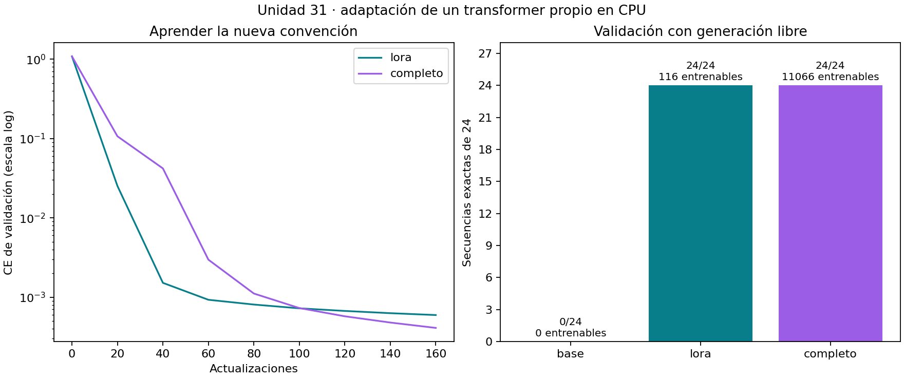
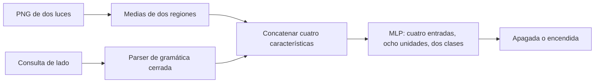
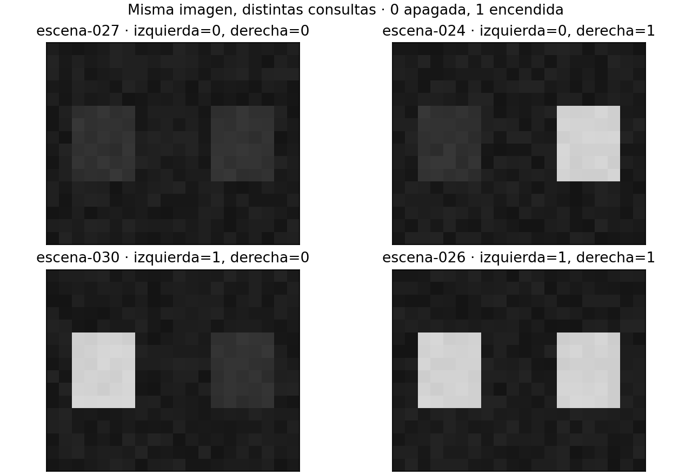
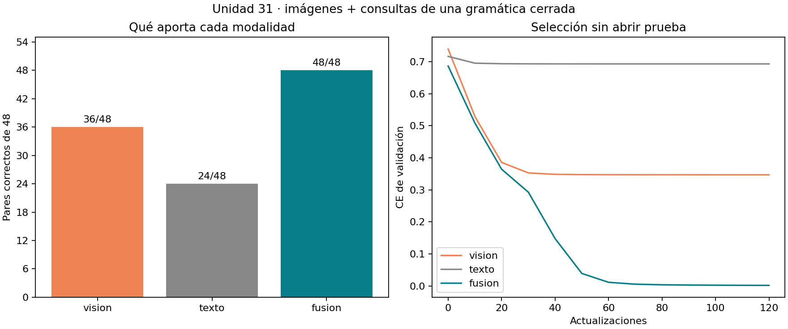

# Unidad 31 — Adaptación de modelos y multimodalidad

[Índice del curso](../README.md) · [Unidad anterior](../unidad30-herramientas-agentes-mcp/README.md)

**Pregunta guía:** ¿cuándo conviene adaptar un modelo y cómo evaluar varias modalidades sin confundir un ejemplo pequeño con una mejora general?

Un modelo ya entrenado puede necesitar una convención nueva de salida. Una aplicación también puede necesitar dos entradas: una imagen muestra dos luces, pero el texto indica cuál consultar. Esta unidad estudia ambos problemas en laboratorios separados, con modelos pequeños, datos propios y ejecución en CPU.

El primer laboratorio adapta el transformer de la Unidad 25 mediante ajuste completo y LoRA. El segundo aprende un clasificador sobre características de imágenes y consultas de una gramática cerrada. **No se descarga ni ajusta un gran modelo de lenguaje o de visión-lenguaje.** Cada resultado se compara con una referencia programada que conoce la regla de la tarea.

## Objetivos y entorno

Al terminar podrás:

1. Diferenciar instrucciones en el contexto, recuperación y modificación de parámetros.
2. Implementar una actualización de bajo rango, contar parámetros y comprobar qué pesos cambian.
3. Adaptar un modelo existente con particiones y criterios fijados antes de evaluar.
4. Recuperar y fusionar un adaptador asociado a una base concreta.
5. Combinar características de imagen y texto, conservando el emparejamiento de entradas.
6. Comparar modalidades aisladas, rechazar entradas incompatibles y explicar límites de generalización.

Prerrequisitos: [PyTorch](../unidad20-pytorch/README.md), [visión](../unidad21-vision-computador/README.md), [transformers](../unidad25-transformers-generativos/README.md) y separación entre entrenamiento, validación y prueba. Tiempo orientativo: 5–7 horas con ejercicios; el reto requiere trabajo adicional.

Se comprobó el 10 de octubre de 2026 con Python 3.12.3, PyTorch 2.14.1+cpu, NumPy 2.2.6, Matplotlib 3.10.8 y Pillow 12.3.0. Se reutilizó el entorno del curso sin instalar paquetes ni descargar pesos. Los requisitos remiten al entorno de la Unidad 21:

```bash
python -m pip install -r unidad31-adaptacion-multimodalidad/requirements.txt
python -m pip install -r unidad31-adaptacion-multimodalidad/requirements-cpu.txt
```

La instalación inicial necesita Internet; las prácticas posteriores funcionan sin red, cuentas, Ollama ni GPU. Los datos y estados pequeños se incluyen en el repositorio. Ejecuta todos los comandos desde su raíz con el entorno virtual activo.

## 1. Elegir qué cambiar

| Enfoque | Qué cambia | Cuándo puede ayudar | Qué debes evaluar |
|---|---|---|---|
| Prompting | Instrucciones, ejemplos o contexto de entrada | Explicar una tarea que el modelo puede realizar | Respuesta, estabilidad y costo de contexto |
| RAG | Documentos recuperados y contexto aportado | Consultar fuentes y datos actualizables | Recuperación, citas, suficiencia y respuesta |
| Ajuste completo | Los parámetros del modelo | Aprender un comportamiento a partir de ejemplos | Mejora, generalización y cambios en otras tareas |
| Adaptación eficiente | Un subconjunto de parámetros o parámetros añadidos | Modificar un comportamiento con menos variables entrenables | Calidad, tamaño del adaptador y dependencia de la base |

No son alternativas mutuamente excluyentes: una aplicación puede combinar un modelo adaptado con recuperación. Tampoco hay que entrenar si una regla explícita resuelve el problema. En esta unidad las reglas son referencias fuertes; los modelos sirven para estudiar el mecanismo y su evaluación.

El ajuste necesita ejemplos de entrada y objetivo, una pérdida y una partición de validación. Repetir datos incorrectos o filtrados puede enseñar el comportamiento equivocado con una pérdida baja. Adaptar no convierte automáticamente respuestas en hechos verificados ni incorpora mecanismos de autorización.

## 2. LoRA paso a paso

Una capa lineal tiene pesos \(W_0\) de tamaño \(d_{salida}\times d_{entrada}\). LoRA mantiene esos pesos y aprende una actualización factorizada:

\[
W=W_0+\frac{\alpha}{r}BA,\qquad
A\in\mathbb R^{r\times d_{entrada}},\quad
B\in\mathbb R^{d_{salida}\times r}.
\]

La actualización tiene rango como máximo \(r\) y añade \(r(d_{entrada}+d_{salida})\) parámetros entrenables. El trabajo original aplica esta idea a modelos de lenguaje y estudia distintas matrices y rangos. Aquí se implementa una variante didáctica solo en la proyección final; no se reproducen la escala ni los resultados del artículo. [Artículo de LoRA](https://arxiv.org/abs/2106.09685)

Nuestra cabeza convierte 32 características en 26 logits. Con rango 2 necesita `2 × (32 + 26) = 116` parámetros nuevos. El modelo base completo tiene 11.066. El adaptador sin fusionar **sigue necesitando la base** y contiene 11.182 parámetros totales; reducir parámetros entrenables no elimina el costo de cargar el modelo.

Inicializamos A con valores pequeños y B con ceros. La contribución inicial es cero y los logits coinciden exactamente con la base. En el primer backward el gradiente de A es cero porque está multiplicado por B; B sí puede recibir gradiente. Inicializar ambas matrices en cero impediría que arrancara esa rama.

En PyTorch, `requires_grad_(False)` impide acumular gradientes en los parámetros congelados. `eval()` cambia el comportamiento de módulos como dropout; no sustituye la congelación. Tampoco hay que envolver la rama entrenable completa en `no_grad()`: eso impediría aprender A y B. [Autograd y congelación en PyTorch](https://docs.pytorch.org/docs/2.14/notes/autograd.html)

Para entradas por filas, `Linear` calcula `x @ W.T + bias`. Nuestro adaptador usa `linear(linear(x, A), B) × alpha/r`, conservando el sesgo original. [Contrato de Linear](https://docs.pytorch.org/docs/2.14/generated/torch.nn.Linear.html)

### Cálculo manual

```text
W0 = [[1, 0, -1],    A = [[1, -1, 0]],    B = [[ 0.5],    x = [2, 1, 3]
      [0, 2,  1]]                             [-0.5]]
```

Con `r=alpha=1`: `W0 x = [-1, 5]`, `A x = 1` y `B A x = [0.5, -0.5]`. La salida adaptada es `[-0.5, 4.5]`. Fusionar consiste en sumar `BA` a una copia de W0 y obtener la misma salida. En esta matriz diminuta se entrenan cinco parámetros frente a seis: el ahorro depende de dimensiones y rango.

```bash
python unidad31-adaptacion-multimodalidad/soluciones/03_lora_a_mano.py
```

Consulta la [implementación](ejemplos/adaptacion.py), la [solución manual](soluciones/03_lora_a_mano.py) y el [resultado exportado](recursos/manual/lora_manual.json). El ejemplo manual es artificial; los resultados siguientes sí proceden de entrenamiento.

## 3. Laboratorio 1 — Adaptar el transformer del curso

La base es el [checkpoint propio de la Unidad 25](../unidad25-transformers-generativos/recursos/generacion/modelo.json). Genera continuaciones con tema, zona y nivel. Conservamos sus 26 tokens, arquitectura y pesos originales. La nueva tarea aplica una **codificación artificial del nivel de salida**: bajo→alto, medio→bajo y alto→medio. No es una valoración del riesgo ni una mejora del significado de esas palabras.

```text
Prefijo:           tema agua zona norte nivel bajo formato breve salida
Objetivo anterior: agua norte bajo .
Objetivo nuevo:    agua norte alto .
```

Las entradas no cambian, pero los objetivos sí: las dos convenciones entran deliberadamente en conflicto. Esto permite observar el cambio de comportamiento y restaurar el anterior al desactivar LoRA. No sería razonable exigir ambas salidas para el mismo prefijo sin informar al modelo de qué tarea se desea.

Se generan 48 familias tema–zona–nivel, con dos formatos cada una. La nueva partición tiene 24/12/12 familias, equivalentes a 48/24/24 documentos de entrenamiento, validación y prueba. **La reserva corresponde a la adaptación:** 12 de los 24 prefijos de prueba habían aparecido en el entrenamiento de la base, con el objetivo anterior. No se afirma evaluación sobre entradas nunca vistas en todo el historial del modelo. [Datos y procedencia](datos/README.md)

Comparamos base congelada, LoRA de rango 2 en la cabeza y ajuste completo. Ambos entrenamientos realizan 160 actualizaciones; las tasas de aprendizaje prefijadas son distintas. Cada candidato elige su época por menor CE de validación. Después elegimos por más secuencias exactas y, si empatan, menos parámetros entrenables y menor CE. La referencia simbólica queda fuera de esta selección demostrativa. [Protocolo completo](datos/protocolo.md)

```bash
python unidad31-adaptacion-multimodalidad/ejemplos/01_adaptar_transformer.py
python unidad31-adaptacion-multimodalidad/ejemplos/01_adaptar_transformer.py --salida resultados/u31-adaptacion --graficos
```

| Candidato | Entrenables | CE validación | Secuencias exactas |
|---|---:|---:|---:|
| Base congelada | 0 | 1,084684 | 0/24 |
| LoRA | 116 | 0,000595 | 24/24 |
| Ajuste completo | 11.066 | 0,000410 | 24/24 |
| Regla explícita | 0 | No aplica | 24/24 |

Se elige **LoRA** por la regla de desempate. Su menor tamaño entrenable no demuestra menor latencia ni memoria pico, que no se midieron. El ajuste completo tiene menor CE, pero ambos generan las 24 secuencias exactas. La CE usa objetivos previos correctos (*teacher forcing*); la generación codiciosa debe continuar con sus propios tokens y producir EOS dentro de 12 tokens nuevos.



Para evaluar el estado guardado en prueba sin volver a entrenar:

```bash
python unidad31-adaptacion-multimodalidad/ejemplos/01_adaptar_transformer.py --evaluar-prueba --modelo resultados/u31-adaptacion/modelo.json --salida resultados/u31-adaptacion
```

El cierre publicado obtiene **24/24 secuencias, 12/12 familias completas y CE 0,000667**. También puedes usar directamente `unidad31-adaptacion-multimodalidad/recursos/adaptacion/modelo.json` para recargar el resultado incluido. No es necesario repetir el entrenamiento para hacerlo.

### Qué se conserva y qué cambia

La base da 24/24 respuestas según la convención anterior en validación. LoRA activo y ajuste completo dan 0/24 bajo ese criterio antiguo porque aprenden el objetivo incompatible. Esto ilustra un cambio deliberado de tarea; no mide por sí solo olvido de otras capacidades independientes.

Los pesos originales de LoRA permanecen idénticos bit a bit. Desactivarlo recupera exactamente los logits de la base. Fusionarlo en una copia cambia los logits como máximo `5,72e−6`, dentro de la tolerancia fijada `1e−5`. La pequeña diferencia se debe al orden de operaciones en float32. La fusión evita ejecutar las dos proyecciones adicionales; aquí no se midió su velocidad.

El JSON de LoRA conserva solo A/B como parámetros adicionales, junto con configuración, vocabulario y hash de la base. El ajuste completo conserva todos sus pesos. Una base distinta se rechaza aunque tenga las mismas dimensiones. Las huellas detectan cambios accidentales; no autentican un paquete manipulado de forma coordinada. [Estados e informe](recursos/informe.md)

## 4. Qué significa multimodalidad

Una modalidad es una forma de información, como imagen, texto, audio o mediciones temporales. Para combinarlas hay que decidir qué representa cada entrada, cómo se relacionan y dónde se fusionan. En un vídeo con audio importan los tiempos; en imagen y texto, qué objeto describe o consulta el texto. El estudio de Baltrušaitis y colaboradores organiza desafíos como representación, alineación y fusión. [Taxonomía de aprendizaje multimodal](https://arxiv.org/abs/1705.09406)

Nuestro ejemplo tiene dos luces y una consulta. La imagen aporta sus estados; el texto identifica el lado. Una misma imagen puede tener respuestas diferentes según el lado solicitado. Emparejar un texto con la imagen equivocada cambia el problema aunque ambos archivos sean válidos.



Los extractores son programados: no hay CNN, OCR, embeddings de lenguaje ni un modelo preentrenado de visión-lenguaje. Se entrena la MLP sobre la combinación de características. Concatenar es el paso de representación; aprender una decisión con ambas entradas y comprobarla es lo que completa esta práctica de fusión.

## 5. Laboratorio 2 — Consultar una imagen mediante texto

Los [48 PNG propios](datos/multimodal/imagenes/escena-000.png) tienen tamaño 20×16 y modo `L`. Cada escena produce cuatro pares: izquierda/derecha y dos plantillas, `estado ...` y `consulta ...`. Las escenas, con todas sus variantes, se separan en 24/12/12; resultan 96/48/48 pares. Se equilibran los cuatro estados posibles de las luces en cada fase.

La preparación exige PNG, modo y tamaño esperados. Divide intensidades por 255 y calcula medias en dos regiones fijas: filas `[5:11]`, columnas `[2:7]` y `[13:18]`. Pillow permite inspeccionar esas propiedades antes de convertir la imagen en un array. [Lectura de imágenes con Pillow](https://pillow.readthedocs.io/en/stable/reference/Image.html)

El texto produce `[1,0]` para izquierda o `[0,1]` para derecha. No se ajusta un vocabulario con prueba ni se incorpora la etiqueta a las características. La fusión recibe `[media_izquierda, media_derecha, consulta_izquierda, consulta_derecha]`.



### Por qué probar una sola modalidad

Si una imagen tiene una luz encendida y otra apagada, verla sin la consulta no permite saber cuál es la respuesta. En este conjunto equilibrado, una predicción que solo ve imagen tiene un máximo de 75 %: acierta las escenas con luces iguales y solo la mitad de las consultas de escenas distintas. El texto aislado no informa de las luces y tiene un máximo de 50 %.

Una MLP con tanh puede aprender la interacción entre lado y estado. Para estados binarios y una consulta derecha `t`, la regla conocida sería `(1−t) × estado_izquierdo + t × estado_derecho`. Esa multiplicación muestra por qué una combinación puramente aditiva no describe toda la tarea.

```bash
python unidad31-adaptacion-multimodalidad/ejemplos/02_combinar_modalidades.py
python unidad31-adaptacion-multimodalidad/ejemplos/02_combinar_modalidades.py --salida resultados/u31-multimodal --graficos
```

| Entrada de la MLP | Parámetros | CE validación | Aciertos | Familias completas |
|---|---:|---:|---:|---:|
| Solo imagen | 42 | 0,347004 | 36/48 | 6/12 |
| Solo texto | 42 | 0,693147 | 24/48 | 3/12 |
| Fusión | 58 | 0,001843 | 48/48 | 12/12 |
| Regla por intensidad y lado | 0 | No aplica | 48/48 | 12/12 |

Se selecciona fusión por CE de validación. Las ablaciones comparten particiones y receta de entrenamiento, pero la fusión también tiene más parámetros; la comparación no aísla únicamente el efecto de la dimensión. Los límites de información de cada modalidad ayudan a interpretar la diferencia.



```bash
python unidad31-adaptacion-multimodalidad/ejemplos/02_combinar_modalidades.py --evaluar-prueba --modelo resultados/u31-multimodal/modelo.json --salida resultados/u31-multimodal
```

El cierre obtiene **48/48 aciertos, 12/12 familias y CE 0,001879**. La matriz de confusión tiene 24 apagadas y 24 encendidas correctas. El modelo guardado del repositorio también permite este cierre directamente. La recarga conserva exactamente logits y predicciones en el entorno comprobado.

### Entradas incompletas y límites

Los diagnósticos rechazan ausencia de imagen, ausencia de texto, un PNG RGB y `no consultes izquierda; consulta derecha`. El parser exige la gramática exacta: no interpreta negaciones ni lenguaje libre. Estos rechazos pertenecen a la aplicación antes de ejecutar la MLP; no son abstenciones aprendidas.

En una escena con izquierda apagada y derecha encendida, cambiar solo la consulta cambia la predicción correspondiente. Eso demuestra dependencia de ambas entradas en ese caso. No demuestra que el sistema comprenda fotografías, luces movidas, perspectiva, audio o instrucciones nuevas. Una softmax alta tampoco equivale a incertidumbre bien calibrada fuera de estos datos.

## 6. Revisión y trabajo práctico

Resuelve los [diez ejercicios](ejercicios.md), consulta sus [soluciones](soluciones/README.md) y realiza el [reto](reto.md) usando la [plantilla](plantillas/informe.md). Revisa la [ficha de los modelos](recursos/ficha-modelos.md) y el [informe con artefactos](recursos/informe.md).

```bash
python -m unittest discover -s unidad31-adaptacion-multimodalidad/pruebas -v
python herramientas/verificar_curso.py
```

Las 45 pruebas contrastan matemática de LoRA, gradientes, pesos congelados, fusión, particiones, regeneración, modalidades excluidas, etiquetas fuera de las entradas, rechazos y cierres sin entrenamiento. Las tres figuras se inspeccionaron visualmente. La ejecución correcta no demuestra utilidad en datos reales ni superioridad general de un método.

Continúa con la [Unidad 32 — De un modelo a una aplicación](../unidad32-modelo-aplicacion/README.md): reutilizar el modelo de fusión en un servicio, una API y una interfaz local comprobada.
