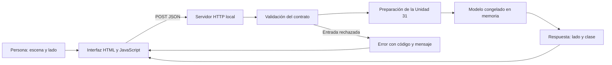

# Unidad 32 — De un modelo a una aplicación

[Índice](../README.md) · [Unidad anterior](../unidad31-adaptacion-multimodalidad/README.md)

**Pregunta guía:** ¿cómo convertir un modelo comprobado en una aplicación que reciba entradas válidas, entregue un resultado comprensible y maneje errores?

Un archivo de pesos no es una aplicación. Además del modelo necesitas una preparación compatible, un contrato, un ciclo de carga y una forma de interactuar. Una predicción correcta en un notebook no garantiza que el navegador envíe la imagen correcta ni que una entrada rechazada deje de mostrar el resultado anterior.

Construiremos **Consulta de luces**, una aplicación local que reutiliza la fusión de imagen y texto de la Unidad 31. La persona elige una escena y un lado; la aplicación devuelve *apagada* o *encendida*. El modelo y los datos ya existen: aquí estudiamos su integración, no una mejora de su exactitud.

## Objetivos y preparación

Al terminar podrás:

1. Definir un caso de uso acotado y distinguir requisitos del modelo y de la aplicación.
2. Separar validación, preparación, inferencia, transporte HTTP e interfaz.
3. Cargar un estado una sola vez, comprobarlo al iniciar y evitar entrenamiento por solicitud.
4. Diseñar respuestas y errores que pueda consumir otro programa.
5. Probar desde una función hasta un recorrido real por HTTP y navegador.
6. Diferenciar una demostración local de un servicio listo para operar en público.

Prerrequisitos: [inferencia y servicios](../unidad26-inferencia-servicios/README.md), [multimodalidad](../unidad31-adaptacion-multimodalidad/README.md), funciones, JSON y manejo de excepciones. Tiempo orientativo: 4–6 horas con ejercicios, más el reto.

Comprobado el 10 de octubre de 2026 con Python 3.12.3, PyTorch 2.14.1+cpu, NumPy 2.2.6 y Pillow 12.3.0. No se instalaron paquetes ni se descargaron pesos nuevos. El servidor usa la biblioteca estándar; la interfaz usa HTML, CSS y JavaScript sin dependencias externas.

Desde la raíz del repositorio, con el entorno virtual activo:

```bash
python -m pip install -r unidad32-modelo-aplicacion/requirements.txt
python -m pip install -r unidad32-modelo-aplicacion/requirements-cpu.txt
python unidad32-modelo-aplicacion/aplicacion/servidor.py
```

Abre [la aplicación local](http://127.0.0.1:8765). Debe aparecer «Aplicación lista». El servidor permanece abierto hasta pulsar `Ctrl+C`. Si el puerto está ocupado, usa `--puerto 8766` y abre la dirección que imprima. No abras `web/index.html` directamente: necesita la API del mismo servidor.

La instalación inicial puede necesitar Internet. Después, la aplicación y las pruebas usan solo archivos del curso y conexiones a `127.0.0.1`; no requieren cuentas, Ollama ni GPU. Un entorno que prohíba sockets locales necesita habilitarlos para estas pruebas. No hay llamadas a servicios externos.

## 1. Del caso de uso al contrato

La persona que estudia quiere consultar una de las dos luces de una escena sintética. El alcance de producto es deliberadamente pequeño:

| Necesidad | Decisión comprobable |
|---|---|
| Elegir una escena conocida | Cuatro PNG de demostración y vista previa |
| Consultar una luz | Selector izquierda/derecha; una consulta por solicitud |
| Saber qué respondió el modelo | Mostrar lado y clase, identificados como predicción |
| Corregir una entrada | Mensaje legible y posibilidad de volver a consultar |
| Evitar confundir resultados | Borrar la respuesta al cambiar imagen o lado |
| Entender el alcance | Aviso visible sobre escenas sintéticas y posiciones fijas |

No se ofrece interpretación general de fotografías. Un PNG de tamaño y modo correctos puede contener píxeles ajenos a la tarea: **validar formato no demuestra que la entrada pertenezca al dominio aprendido**. Esa distinción continúa siendo necesaria aunque el modelo devuelva una clase sin fallar.

La interfaz facilita entradas válidas, pero la API valida de nuevo: otro cliente puede enviar cualquier JSON, sin pasar por el formulario.

## 2. Arquitectura y responsabilidades



| Archivo | Responsabilidad |
|---|---|
| [contrato.py](aplicacion/contrato.py) | JSON, campos, límites, base64, PNG y errores de entrada |
| [servicio.py](aplicacion/servicio.py) | Verificar y cargar el estado; validar e inferir sin HTTP |
| [servidor.py](aplicacion/servidor.py) | Rutas, cabeceras, códigos HTTP, archivos permitidos y ciclo de vida |
| [app.js](web/app.js) | Preparar solicitud, mostrar espera, resultado y errores |
| [index.html](web/index.html) y [estilos.css](web/estilos.css) | Formulario con etiquetas, mensajes y presentación adaptable |

Separar estas piezas permite probar el servicio sin navegador y cambiar la interfaz sin volver a entrenar. Una clase Python no debería necesitar saber qué botón pulsó la persona.

### Cargar una vez

Antes de abrir el puerto, `Servicio` lee el [modelo de fusión de la U31](../unidad31-adaptacion-multimodalidad/recursos/multimodal/modelo.json), compara su SHA-256 con el estado fijado y reutiliza el restaurador original. Este último comprueba configuración, formas y huellas de las fuentes. Después realiza una inferencia pequeña de arranque para detectar una salida no finita o de forma incorrecta.

Si falta el archivo, cambió su contenido o falla la carga, el programa termina con estado 1 y no anuncia que esté listo. Si abre el puerto correctamente, `/health` responde `listo`: esto significa que completó el inicio y puede responder HTTP. No es una prueba continua de exactitud ni garantiza que toda futura consulta funcione.

Cada solicitud usa el mismo objeto en memoria, en modo evaluación y con parámetros congelados. La preparación y la inferencia reutilizan el código de la U31; sus archivos no se modifican. El candado serializa la inferencia entre hilos. El servidor no ajusta pesos ni vuelve a leer el modelo por consulta. Para cambiar el estado hay que revisar el contrato, actualizar deliberadamente la huella y reiniciar: `--modelo` solo admite una copia idéntica del estado fijado.

## 3. Laboratorio 1 — Servicio sin navegador

Ejecuta primero la capa de servicio:

```bash
python unidad32-modelo-aplicacion/ejemplos/01_predecir_sin_http.py
python unidad32-modelo-aplicacion/ejemplos/01_predecir_sin_http.py --salida resultados/u32-servicio.json
```

El programa consulta la luz derecha de la escena 01 y obtiene `encendida`. Después envía un texto fuera de gramática y conserva el rechazo. Los resultados publicados están en [servicio.json](recursos/servicio.json).

La entrada aceptada tiene exactamente dos campos:

```json
{
  "imagen_base64": "BASE64_DEL_PNG",
  "texto": "estado derecha"
}
```

`BASE64_DEL_PNG` es un marcador explicativo, no una imagen válida. Se envían los bytes del PNG codificados, sin prefijo `data:`; no se envía una ruta del equipo. El campo `texto` acepta solo `estado izquierda`, `estado derecha`, `consulta izquierda` o `consulta derecha`.

Los límites son 32 KiB para el cuerpo JSON y 16 KiB para la imagen decodificada. Solo se admiten PNG estáticos de 20×16 en modo `L`. No se convierte silenciosamente un RGB ni se redimensiona una imagen: eso cambiaría la preparación respecto al modelo probado. Pillow abre el contenedor, comprueba sus propiedades y permite verificarlo; además se fuerza la lectura de píxeles para detectar archivos truncados. [Referencia de Image](https://pillow.readthedocs.io/en/stable/reference/Image.html)

El parser exige UTF-8, rechaza claves repetidas y constantes como `NaN`. Python permite personalizar estos comportamientos de su decodificador JSON; limitar el tamaño antes de analizarlo evita aceptar entradas arbitrariamente grandes. [Documentación de json](https://docs.python.org/3.12/library/json.html)

### De píxeles a resultado

Después de validar, la preparación original extrae dos medias de intensidad y una codificación del lado. La MLP consume esas cuatro características. La salida pública tiene una versión de API, el lado, la clase y la identidad del estado. No expone una probabilidad como si fuera confianza calibrada.

```json
{
  "version": "1",
  "estado": "ok",
  "resultado": {"lado": "derecha", "clase": "encendida"},
  "modelo": {"id": "fusion-u31", "sha256": "HUELLA_COMPLETA_DE_64_CARACTERES"}
}
```

El [contrato completo](recursos/contrato-api.md) contiene los códigos y límites. Las respuestas guardadas incluyen la huella real. Un hash identifica bytes y detecta cambios accidentales; no acredita por sí solo un origen confiable si también se modifica la aplicación que lo comprueba.

## 4. Laboratorio 2 — API e interfaz

Con el servidor abierto, realiza este recorrido:

1. Conserva la escena «Derecha encendida» y elige «Izquierda».
2. Consulta: debe aparecer «Predicción · luz izquierda / Apagada».
3. Cambia a «Derecha»: el resultado anterior debe desaparecer.
4. Consulta: debe aparecer «Encendida».
5. En «Usar un PNG propio», prueba una imagen RGB de 20×16: debe rechazarse por modo incompatible.
6. Elige otra escena del curso y vuelve a consultar. El error debe desaparecer y el formulario debe funcionar.

No se requiere un archivo personal para el paso 5. Puedes generar uno artificial:

```bash
python -c "from PIL import Image; Image.new('RGB',(20,16),'white').save('resultados-rgb-u32.png')"
```

La [captura de una consulta](recursos/interfaz.jpg) y la [captura del rechazo](recursos/interfaz-error.jpg) documentan el recorrido revisado en el navegador. La vista comprobada utiliza la disposición estrecha de una columna; la hoja de estilos define dos columnas a partir de 701 px. No se presenta esta revisión como certificación de accesibilidad ni como prueba de todos los navegadores o tamaños.

### Qué hace el navegador

La interfaz consulta primero `/health` y carga el catálogo. Al enviar, lee el PNG, lo codifica en base64 y usa `fetch` con `Content-Type: application/json`. Comprueba `response.ok`: recibir un 422 es una respuesta HTTP, no necesariamente una excepción de red. Un `AbortController` limita a cinco segundos la espera del `fetch`; cancelar en el cliente no garantiza detener trabajo que ya comenzó en el servidor. [Uso de Fetch](https://developer.mozilla.org/en-US/docs/Web/API/Fetch_API/Using_Fetch)

Mientras espera, desactiva los controles. Al terminar, siempre los vuelve a habilitar. Un error no conserva la predicción anterior. Los mensajes usan `textContent`, etiquetas asociadas a controles y regiones de estado; la consulta también se comprobó con teclado.

### Comprobación HTTP reproducible

No necesitas dejar un servidor abierto para ejecutar:

```bash
python unidad32-modelo-aplicacion/ejemplos/02_comprobar_http.py
python unidad32-modelo-aplicacion/ejemplos/02_comprobar_http.py --salida resultados/u32-http.json
```

El programa abre un servidor real en un puerto local libre, envía solicitudes con `http.client` y lo cierra incluso si ocurre un error. La captura publicada da **24/24 comprobaciones correctas**:

| Grupo | Casos | Qué comprueba |
|---|---:|---|
| Cuatro escenas × dos lados | 8 | Predicción esperada e identidad del modelo |
| Entradas, rutas y método inválidos | 10 | Estado HTTP y código de error, sin predicción |
| Interfaz, estado, modelo y catálogo | 6 | Disponibilidad de los recursos |

El [informe HTTP](recursos/http.json) conserva respuestas reales. Las escenas proceden de la validación de la U31 y ya se conocían. **24/24 mide estos contratos funcionales, no exactitud sobre 24 ejemplos nuevos ni nueva generalización.** Las ocho predicciones usan cuatro imágenes, no ocho escenas independientes. El [protocolo](datos/protocolo.md) fija ese alcance.

## 5. Errores y límites de operación

Un error de entrada debe ayudar a corregirla; un fallo interno debe avisar sin inventar una predicción:

| Situación | Estado | Acción para quien usa la aplicación |
|---|---:|---|
| JSON inválido | 400 | Corregir la estructura y la codificación |
| Cuerpo o imagen demasiado grandes | 413 | Usar una imagen pequeña compatible |
| Tipo de contenido incorrecto | 415 | Enviar JSON |
| PNG, texto o campos incompatibles | 422 | Corregir la entrada indicada |
| Fallo inesperado de inferencia | 500 | Revisar el servidor; no mostrar una clase |
| Servidor detenido | Sin respuesta HTTP | Reiniciarlo y reintentar desde la interfaz |

El servidor escucha solo en `127.0.0.1`, sirve una lista fija de archivos y comprueba Host/Origin. No guarda imágenes o consultas en disco. Su registro en stderr incluye método, estado y duración, sin cuerpo ni texto del usuario. Estos controles son parte de una demostración local, no una garantía frente a todo ataque.

`http.server` se elige para hacer visible el transporte sin añadir paquetes; Python no lo recomienda para producción. No hay autenticación, TLS, cuotas por usuario, límites globales de concurrencia ni despliegue público. [Documentación de http.server](https://docs.python.org/3.12/library/http.server.html)

La duración registrada incluye la atención de una solicitud desde su manejador; no es una medición de latencia completa de usuario, de capacidad bajo carga ni de tiempo puro de GPU/CPU. Esta unidad no publica un benchmark de rendimiento. La Unidad 33 ampliará operación, seguridad y observabilidad antes de considerar un servicio real.

## 6. Bytes, pruebas y entrega

Una imagen de 16.384 bytes ocupa `4 × ceil(16384/3) = 21848` caracteres base64. El JSON añade nombres de campos y delimitadores: el ejemplo ocupa **21.896 bytes**, dentro de 32 KiB. `Content-Length` cuenta los bytes UTF-8 de todo el cuerpo, no solo los caracteres visibles. El cálculo es sobre bytes artificiales; no representa una imagen admisible.

```bash
python unidad32-modelo-aplicacion/soluciones/03_tamano_peticion.py
python -m unittest discover -s unidad32-modelo-aplicacion/pruebas -v
python herramientas/verificar_curso.py
```

Las **44 pruebas** cubren validación, reutilización de la preparación, pesos sin cambios, ausencia o modificación del modelo, rutas, cabeceras, cuerpo truncado, errores de inferencia, registros sin entradas y reconstrucción de la captura HTTP. Usan conexiones locales reales; la prueba del formulario se documenta por separado. El verificador común no controla un navegador.

Completa los [diez ejercicios](ejercicios.md), contrasta las [soluciones](soluciones/README.md) y realiza el [reto](reto.md) con la [plantilla](plantillas/informe.md). Consulta también la [ficha de la aplicación](recursos/ficha-aplicacion.md), las [evidencias](recursos/informe.md) y el [guion de revisión manual](recursos/revision-interfaz.md).

**Siguiente unidad prevista:** 33 — Operación, seguridad y observabilidad; pendiente de desarrollo.
