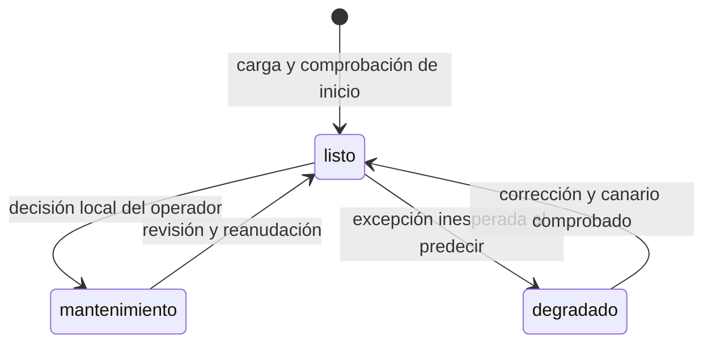
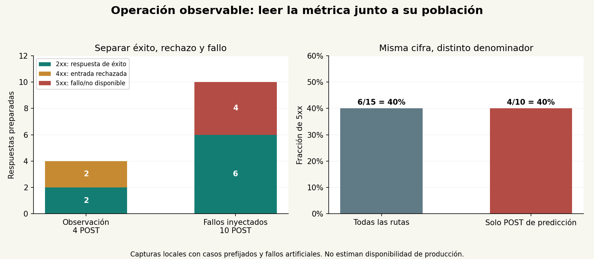

# Unidad 33 — Operación, seguridad y observabilidad

[Índice del curso](../README.md) · [Unidad anterior](../unidad32-modelo-aplicacion/README.md)

**Pregunta guía:** ¿cómo operar una aplicación de IA con límites, registros útiles y capacidad de atender fallos, sin confundir disponibilidad con calidad predictiva?

La aplicación de la Unidad 32 ya recibe imágenes y consultas. Ahora necesitamos responder otras preguntas: ¿qué ocurre si llega una segunda consulta mientras el modelo está ocupado?, ¿cómo relacionar un error con su registro?, ¿puede el proceso seguir vivo aunque deba dejar de aceptar predicciones?

Esta unidad añade una capa de operación al servidor local anterior. Conserva el modelo, la preparación, los cuerpos de predicción y la interfaz. **No despliega un servicio público ni entrena otro modelo.** Los fallos se provocan de forma explícita en un envoltorio de laboratorio, mediante conexiones HTTP reales.

## Objetivos y entorno

Al terminar podrás:

1. Diferenciar proceso vivo, preparación para atender, capacidad momentánea y calidad del modelo.
2. Limitar conexiones y solicitudes admitidas sin crear una cola de inferencia ilimitada.
3. Correlacionar respuestas y registros sin guardar entradas o detalles privados.
4. Interpretar contadores, tasas, duración, histogramas y objetivos con denominadores explícitos.
5. Comprobar saturación, mantenimiento, degradación, recuperación y abandono del cliente.
6. Preparar un cambio de versión y una reversión local con evidencia.

Prerrequisitos: [servicios de inferencia](../unidad26-inferencia-servicios/README.md), [aplicación local](../unidad32-modelo-aplicacion/README.md), JSON, excepciones y lectura básica de HTTP. Tiempo orientativo: 5–7 horas con ejercicios, más el reto.

Se verificó el 10 de octubre de 2026 con Python 3.12.3, PyTorch 2.14.1+cpu, NumPy 2.2.6, Pillow 12.3.0 y Matplotlib 3.10.8. Se reutilizaron las dependencias y los pesos existentes, sin instalaciones nuevas.

```bash
python -m pip install -r unidad33-operacion-seguridad-observabilidad/requirements.txt
python -m pip install -r unidad33-operacion-seguridad-observabilidad/requirements-cpu.txt
```

Ejecuta los comandos desde la raíz con el entorno virtual activo. La instalación inicial puede necesitar Internet. Los laboratorios posteriores usan solo archivos del curso y sockets en `127.0.0.1`; un entorno que bloquee conexiones locales deberá permitirlas. No requieren cuentas, servicios externos ni GPU.

## 1. Estar vivo no equivale a estar listo

| Señal | Pregunta | Implementación de la práctica |
|---|---|---|
| Inicio | ¿Se cargaron estado y preparación? | La U32 verifica el modelo antes de abrir el puerto |
| Liveness | ¿Este proceso pudo atender la sonda? | `GET /live` responde 200 si el manejador la atiende |
| Readiness | ¿La política permite nuevas predicciones? | `GET /ready` responde 200 en `listo`, 503 en otros estados |
| Capacidad momentánea | ¿Hay una consulta ya admitida? | `ocupado=true`; otra predicción recibe 503 |
| Calidad predictiva | ¿El resultado es correcto para su uso? | Necesita datos y criterios aparte; no se deduce de las sondas |

La distinción conceptual entre sondas de inicio, liveness y readiness aparece también en sistemas de orquestación. Aquí no se instala Kubernetes: las rutas locales permiten estudiar esos significados. Una sonda que no responde durante saturación no permite diagnosticar por sí sola si murió el proceso. [Sondas de Kubernetes](https://kubernetes.io/docs/concepts/workloads/pods/probes/)

El estado sigue estas transiciones:



`ocupado` es una condición independiente: una consulta puede haber sido admitida antes de entrar en mantenimiento. Se le permite terminar; las nuevas se rechazan. Esto demuestra una política de admisión, pero **cerrar el proceso no garantiza drenar los hilos bloqueados**. El ejemplo usa hilos daemon y documenta esa limitación.

No hay una ruta HTTP para cambiar estados o inyectar fallos. El laboratorio los modifica desde Python dentro del proceso de prueba. La CLI permite iniciar en mantenimiento; para cambiar ese modo de la CLI se detiene y reinicia el proceso local.

## 2. Limitar recursos en dos puntos

El [servidor operado](ejemplos/operacion.py) hereda el manejador de la U32 y añade dos controles:

1. **Hasta cuatro conexiones manejadas simultáneamente.** Un semáforo se adquiere antes de crear el hilo y se libera al finalizarlo. Una conexión excedente recibe un 503 de mejor esfuerzo y se cierra antes de leer su solicitud.
2. **Una solicitud de predicción admitida, sin cola de aplicación.** Un bloqueo protege la comprobación y el cambio de `ocupado`. La segunda consulta recibe 503 inmediatamente, con `Retry-After: 1`. La admisión precede a la validación del contenido: durante saturación también una entrada inválida puede recibir 503.

El servidor anterior serializaba el acceso al modelo con un candado, pero podía acumular hilos esperando. Ahora se limita la admisión antes de llegar a esa espera. Se mantienen los límites de la U32: 32 KiB de cuerpo y 16 KiB de PNG. Python ofrece mixins de hilos y mecanismos de sincronización para implementar estos controles. [Socketserver](https://docs.python.org/3.12/library/socketserver.html), [threading](https://docs.python.org/3.12/library/threading.html)

El límite de cuatro no cuenta el hilo principal ni las conexiones pendientes en el backlog del sistema operativo. Tampoco garantiza que un cliente reciba el rechazo si cierra la conexión. Limita hilos de manejo; no certifica resistencia a denegación de servicio.

### Tres tiempos diferentes

| Tiempo | Qué controla aquí | Qué no controla |
|---|---|---|
| Timeout de socket: 1 s por operación | Espera de lectura/escritura en cada manejador | Duración total de una solicitud que avanza lentamente |
| Timeout del cliente | Cuánto espera ese cliente por una operación de red | Cancelación del trabajo ya iniciado en el servidor |
| Objetivo ilustrativo: 100 ms | Clasificación de resultados al observarlos | No interrumpe ni cancela una inferencia lenta |

No hay un plazo duro de inferencia. Un cálculo que no termina retiene el único cupo hasta finalizar o cerrar el proceso; los demás reciben rechazo. Para imponer una cancelación fuerte habría que estudiar aislamiento de procesos, interrupción y recuperación. No basta con dejar de esperar a un hilo.

## 3. Registros que permiten investigar

Cada solicitud que llega al manejador recibe un UUID nuevo del servidor. Se devuelve como `X-Request-ID` y aparece en un evento JSON. Una cabecera enviada por el cliente con ese nombre se ignora para generar el identificador; no se copia al registro.

Los eventos tienen solo estos campos:

```json
{
  "evento": "http",
  "solicitud_id": "UUID_HEXADECIMAL_GENERADO",
  "ruta": "prediccion",
  "metodo": "POST",
  "status": 503,
  "codigo": "ocupado",
  "duracion_ms": 0.3,
  "modelo_sha256": "HUELLA_DEL_ESTADO"
}
```

El ejemplo es esquemático; las [capturas](recursos/observacion.json) contienen los valores reales. No se guardan la imagen, el texto, la URL arbitraria, la IP ni mensajes completos de excepciones. Las rutas se agrupan en un vocabulario finito: `prediccion`, `live`, `ready`, `metricas`, `estatico` y `otros`. El UUID sirve para correlacionar, **no se usa como etiqueta de un contador**.

Elegir qué registrar y excluir secretos o datos sensibles es parte del diseño del registro, no un paso posterior de limpieza. El esquema pequeño de esta práctica sigue ese principio; no sustituye una política completa de retención y acceso. [Guía de registros de OWASP](https://cheatsheetseries.owasp.org/cheatsheets/Logging_Cheat_Sheet.html)

El historial en memoria conserva como máximo 256 eventos; los contadores acumulan desde el inicio. La CLI emite los eventos a stderr. Si los rediriges a un archivo, debes definir retención y acceso: el límite de la deque **no limita el archivo redirigido**. Un reinicio vuelve a cero los contadores.

## 4. Métricas con una población definida

Para `POST /api/predecir`, el [observador](ejemplos/observacion.py) conserva total, respuestas 2xx, rechazos 4xx y fallos/no disponibilidad 5xx. La tasa definida es:

\[
\text{tasa 5xx} = \frac{\text{POST de predicción con 5xx}}{\text{todos los POST de predicción terminados}}.
\]

También calcula la fracción de respuestas 2xx preparadas en no más de 100 ms sobre ese mismo total. Los rechazos cuentan en el denominador; una respuesta de error muy rápida no se convierte en una respuesta buena. Sin solicitudes, las tasas y la media son `null`: no hay evidencia de una tasa cero.

La duración comienza en el manejador, después de analizar las cabeceras, y termina antes de escribir la respuesta. No es latencia de usuario ni tiempo puro del modelo. El contador describe **respuestas preparadas**, no recepción confirmada: un cliente puede haber abandonado antes.

Las sondas y archivos no diluyen el denominador de predicción. Los rechazos de conexión previos a leer HTTP se cuentan aparte: todavía se desconoce ruta y método. Los errores que el parser HTTP rechaza antes del manejador tampoco se incluyen en estas métricas de aplicación.

### Ejemplo manual

Cinco POST artificiales tienen estados `[200, 200, 422, 503, 500]` y tiempos `[10, 30, 5, 2, 90]` ms. Con un objetivo de 20 ms:

- Tasa 5xx: `2/5 = 40 %`.
- Fracción buena: `1/5 = 20 %`; el 503 de 2 ms no cuenta como éxito.
- Media: `(10+30+5+2+90)/5 = 27,4 ms`, sobre éxitos y errores.
- p95 por rango más cercano: posición `ceil(0,95×5)=5`; en los tiempos ordenados es 90 ms.

```bash
python unidad33-operacion-seguridad-observabilidad/soluciones/03_operacion_a_mano.py
```

Los histogramas guardan conteos acumulados hasta 1, 5, 20, 100, 500 y 2000 ms, más `+Inf`. Se pueden sumar conteos con los mismos límites; no se recuperan todos los tiempos exactos ni se deben promediar percentiles de grupos para calcular un percentil global. Esta práctica usa un JSON didáctico, no un exportador Prometheus. [Histogramas y resúmenes](https://prometheus.io/docs/practices/histograms/)

Un indicador observado puede compararse con un objetivo interno (SLO) en una ventana y población definidas. No se transforma por eso en un compromiso contractual (SLA). Los 100 ms de esta práctica son ilustrativos; no se declara que el servicio cumpla una disponibilidad o latencia de producción.

## 5. Laboratorio 1 — Observar solicitudes reales

```bash
python unidad33-operacion-seguridad-observabilidad/ejemplos/01_observar_servicio.py
python unidad33-operacion-seguridad-observabilidad/ejemplos/01_observar_servicio.py --salida resultados/u33-observacion.json
```

El programa carga el modelo una vez, abre un servidor temporal en loopback, envía ocho solicitudes y lo cierra. La [captura publicada](recursos/observacion.json) tiene ocho respuestas con ocho eventos correlacionados. Sus cuatro POST de predicción contienen dos 200, un 422 por campos y un 403 por origen; las otras solicitudes comprueban sondas, ruta desconocida y métricas.

`GET /metricas` devuelve una instantánea tomada antes de registrar su propia respuesta: esa consulta aparece como `en_curso=1`, y el total final incluye una respuesta más. No es un contador perdido.

Para examinar el servicio manualmente:

```bash
python unidad33-operacion-seguridad-observabilidad/ejemplos/operacion.py
```

La [interfaz heredada](http://127.0.0.1:8766) funciona en el puerto 8766. Puedes abrir [liveness](http://127.0.0.1:8766/live), [readiness](http://127.0.0.1:8766/ready) y [métricas](http://127.0.0.1:8766/metricas). La API conserva los cuerpos de la U32 y añade las cabeceras de correlación/reintento. Se comprueban por HTTP los archivos originales de interfaz; esta entrega no añade otro diseño ni afirma una nueva revisión de navegador.

## 6. Laboratorio 2 — Fallar y recuperarse

```bash
python unidad33-operacion-seguridad-observabilidad/ejemplos/02_probar_fallos.py
python unidad33-operacion-seguridad-observabilidad/ejemplos/02_probar_fallos.py --salida resultados/u33-fallos.json
```

El envoltorio `BaseControlada` retiene una llamada con un evento de sincronización o lanza una excepción artificial. Las solicitudes, respuestas, tiempos y cambios de estado son reales; el origen del bloqueo y de la excepción es deliberadamente artificial. Los casos normales sí ejecutan el modelo de la U31.

| Escenario | Resultado observado |
|---|---|
| Primera consulta retenida; llega otra | Segunda: 503 `ocupado`; la admitida termina con 200 al liberarla |
| Consultar sondas mientras hay inferencia | `/live` y `/ready` responden 200; readiness informa `ocupado=true` |
| Entrar en mantenimiento con trabajo admitido | `/ready` da 503; nuevas predicciones se rechazan; la admitida termina |
| Excepción artificial del servicio | 500 sin detalle privado; estado `degradado` |
| Sondas y nueva predicción en degradado | `/live` 200; `/ready` y predicción 503 |
| Corregir el envoltorio y comprobar un canario | Reanudar permite volver a responder 200 |
| Cliente agota 0,1 s de espera | El servidor sigue ocupado; después prepara un 200 que el cliente no recibe |
| Una conexión permitida ya ocupada | La siguiente conexión recibe 503 antes de enviar HTTP; se cuenta aparte |

La captura principal tiene **14 respuestas recibidas y 15 eventos**: el evento adicional pertenece a la consulta cuyo cliente abandonó. Sobre los diez POST, el servidor preparó seis 200 y cuatro 5xx. En esta captura, cinco de los diez cumplieron además el objetivo ilustrativo de 100 ms. Los tiempos y esa última cifra pueden cambiar al repetir; los estados y relaciones se comprueban sin fijar duraciones exactas.

La prueba separada de conexiones recibe un rechazo previo a HTTP y una respuesta 200 de la llamada admitida. No se suman al denominador del experimento principal. El canario directo de recuperación también se conserva aparte y no se cuenta como solicitud HTTP.



Los dos 40 % del panel derecho significan `6/15` en todas las rutas y `4/10` en predicción. Son poblaciones distintas aunque la cifra coincida. Estos casos prefijados con fallos inyectados no estiman frecuencia de incidentes, disponibilidad real ni exactitud del modelo.

## 7. Seguridad, cambios e incidentes

La [matriz de riesgos](recursos/riesgos.md) relaciona problemas con controles y límites comprobados. El servidor conserva loopback, Host/Origin, lista de archivos y validación de la U32. No contiene autenticación ni TLS; Host/Origin no identifican a una persona ni impiden a un proceso local construir sus propias cabeceras. `http.server` sigue siendo una herramienta didáctica, no una plataforma de producción.

Un cambio operativo debe identificar código, configuración, dependencias y estado del modelo. El [procedimiento de cambio y reversión](recursos/operacion-local.md) utiliza las dos versiones del curso sin sobrescribirlas. Las capturas conservan hashes del código que generó la evidencia, además de la huella del modelo. Las huellas detectan cambios; no firman su procedencia.

Ante un incidente, primero distingue el síntoma: carga fallida, entrada rechazada, saturación, excepción o respuesta predictiva incorrecta. Conserva evidencia mínima, limita nuevas solicitudes si corresponde, corrige y comprueba una recuperación antes de reanudar. Reiniciar sin diagnosticar puede borrar los contadores y repetir el fallo.

## 8. Verificación y trabajo práctico

```bash
python -m unittest discover -s unidad33-operacion-seguridad-observabilidad/pruebas -v
python unidad33-operacion-seguridad-observabilidad/ejemplos/figuras.py --salida resultados/u33-figuras
python herramientas/verificar_curso.py
```

Las **41 pruebas** cubren admisión, liberación de cupos, mantenimiento, errores, correlación, privacidad, límites de memoria del historial, denominadores, histogramas, timeout de lectura y recuperación por HTTP real. Reconstruyen métricas de la evidencia conservada y contrastan estados al repetir los laboratorios. No fijan UUID ni tiempos exactos entre ejecuciones. La figura PNG/SVG se revisó visualmente.

Resuelve los [diez ejercicios](ejercicios.md), consulta las [soluciones](soluciones/README.md) y desarrolla el [reto](reto.md) con la [plantilla](plantillas/informe.md). Revisa [datos y protocolo](datos/README.md), la [ficha del servicio](recursos/ficha-servicio.md) y el [informe de evidencia](recursos/informe.md).

**Siguiente:** [Unidad 34 — Talleres de IA aplicada](../unidad34-talleres-ia-aplicada/README.md).
