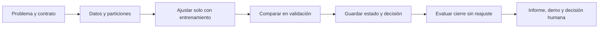

# Unidad 34 — Talleres de IA aplicada

[Índice del curso](../README.md) · [Unidad anterior](../unidad33-operacion-seguridad-observabilidad/README.md)

**Pregunta guía:** ¿cómo pasar de técnicas aisladas a una solución pequeña cuya utilidad y límites se puedan revisar?

En estos talleres una persona necesita una salida concreta: estimar la demanda de la próxima hora, proponer registros ambientales para revisión o encontrar un fragmento que responda una pregunta. Elegiremos modelos por el problema y la evidencia disponible. Los tres talleres usan datos propios ficticios; sus resultados enseñan el procedimiento y no validan una instalación, una política ambiental ni una institución real.

## Objetivos y recorrido

Al terminar podrás delimitar un usuario y una decisión, construir una referencia útil, separar los datos según el uso previsto, elegir con validación, evaluar un estado congelado y entregar una demostración con contrato y análisis de errores.

| Taller | Usuario y decisión | Referencia | Separación | Evidencia principal |
|---|---|---|---|---|
| [1. Energía e IoT](talleres/01-energia.md) | Responsable de un edificio ficticio: revisar una estimación de potencia para la hora siguiente | Última lectura | Tiempo | MAE en kW y error tras un cambio de nivel |
| [2. Gestión ambiental](talleres/02-ambiente.md) | Equipo de campo ficticio: revisar propuestas de visita | Proponer ninguna o todas | Zonas completas | Costo de FP/FN y omisiones por zona |
| [3. Educación y documentos](talleres/03-documentos.md) | Estudiante de una institución ficticia: consultar un procedimiento | Solapamiento de palabras | Familias de preguntas | Pertinencia, abstención, cobertura y citas |

Ruta sugerida: 2–3 horas por taller y 2 horas para la entrega comparativa. Puedes profundizar en uno después de reproducir los tres. Prerrequisitos: [flujo de evaluación](../unidad10-flujo-lineas-base/README.md), [métricas y decisiones](../unidad17-metricas-decisiones/README.md), [lenguaje natural](../unidad22-lenguaje-natural/README.md), [series temporales](../unidad23-series-temporales/README.md) y [operación](../unidad33-operacion-seguridad-observabilidad/README.md).

## 1. Un contrato antes del modelo

Cada taller tiene una entrada permitida, una salida acotada y una acción humana posterior. Energía devuelve una estimación de potencia; ambiente propone una revisión; documentos devuelve un párrafo o `sin_evidencia`. Los programas no controlan equipos, no programan visitas ni califican estudiantes.

El [protocolo](datos/protocolo.json) fija candidatos, particiones, costos y desempates antes de ejecutar las comparaciones. Los costos son unidades ficticias de decisión, no dinero ni normas técnicas. Las [fichas de datos](datos/README.md) explican de dónde salen las etiquetas y qué no representan.



En documentos el ajuste del índice usa el corpus fijo completo: ese corpus es la base consultable, no un conjunto de preguntas de prueba. Las preguntas de validación sirven para elegir el método y el umbral; las familias de cierre se reservan. Esta diferencia se detalla en el tercer taller.

Separar antes de aprender transformaciones y conservar la misma preparación al inferir evita una fuente habitual de filtración. Aquí escala, coeficientes e índice se guardan juntos. [Prácticas recomendadas de scikit-learn](https://scikit-learn.org/stable/common_pitfalls.html)

## 2. Entorno y primera ejecución

Verificado el 10 de octubre de 2026 con Python 3.12.3, NumPy 2.2.6, scikit-learn 1.9.1 y Matplotlib 3.10.8. Se reutilizó el entorno del curso, sin instalar paquetes ni descargar modelos. La ruta básica funciona en CPU y sin cuentas, claves, sockets, Ollama o PyTorch.

Desde la raíz del repositorio, con el entorno virtual activo:

```bash
python -m pip install -r unidad34-talleres-ia-aplicada/requirements.txt
python unidad34-talleres-ia-aplicada/ejemplos/01_taller_energia.py
python unidad34-talleres-ia-aplicada/ejemplos/02_taller_ambiente.py
python unidad34-talleres-ia-aplicada/ejemplos/03_taller_documentos.py
```

La instalación inicial puede necesitar Internet. Los tres programas posteriores leen archivos locales, muestran la comparación de validación y comprueban una recarga JSON. **Por defecto no leen prueba ni escriben resultados.** Las guías de cada taller explican cómo guardar el modelo y abrir después el cierre.

Las versiones compartidas están fijadas en [requirements.txt](requirements.txt). Para recrear solo los datos en otra carpeta:

```bash
python unidad34-talleres-ia-aplicada/datos/generar_datos.py --salida resultados/u34-datos
```

El generador reproduce los nueve archivos de datos; el protocolo se conserva por separado. Generar las particiones no equivale a usarlas para ajustar: la función de desarrollo solo carga entrenamiento/corpus y validación. En un trabajo real, una persona distinta puede custodiar el cierre; el material público del curso ya permite conocer sus respuestas.

## 3. Tres métricas que no se deben mezclar

Antes de ejecutar, resuelve estos casos separados:

1. Energía: valores `[10, 14, 12]` y predicciones `[11, 11, 14]`. Errores absolutos: 1, 3 y 2; **MAE = 2 kW** sobre tres decisiones.
2. Ambiente: un falso positivo y un falso negativo; costos FP=1 y FN=4. **Costo = 5** sobre cuatro registros. No es una tasa de error.
3. Documentos: respuesta pertinente, respuesta incorrecta, abstención en pregunta respondible y abstención correcta. Costos 0, 3, 1 y 0: **costo = 4**. Se responden dos de cuatro preguntas; solo una de las dos respuestas es pertinente. Cobertura y precisión entre respondidas valen 0,5, por razones distintas.

```bash
python unidad34-talleres-ia-aplicada/soluciones/05_decidir_a_mano.py
```

No tiene significado promediar 2 kW, 5 unidades de costo ambiental y 4 de costo documental para construir una «nota global del modelo». Elige métricas por la decisión y comunica población, unidad y criterio.

## 4. Resultados conservados

| Taller | Elección con validación | Cierre del mismo estado | Limitación observada |
|---|---|---|---|
| Energía | Ridge: MAE 1,1853 kW; persistencia: 1,9953 | MAE 3,5479 kW, 192 decisiones | La estimación queda baja después de un cambio artificial de +5 kW |
| Ambiente | Logística con umbral 0,3: costo 43; ninguna: 220; todas: 65 | Costo 76; 12 FP y 16 FN en 120 registros | Z11 concentra 12 de las 16 omisiones |
| Documentos | TF-IDF con umbral 0,4: 10/12 aceptadas, costo 4; referencia: 9/12, costo 9 | 8/12 aceptadas, costo 6; 6 respuestas | Una cita sobre tutoría no responde si hay transporte hasta ella |

Los candidatos se comparan en validación. El cierre evalúa únicamente al elegido, sin repetir la selección ni reajustar con validación. No se afirma que el elegido supere a todas las referencias en el cierre. El [informe completo](recursos/informe.md) conserva la decisión y los fallos; las guías muestran las figuras y sus denominadores.

## 5. Probar una entrada y entregar evidencia

La [demostración por terminal](ejemplos/04_demostrar_taller.py) carga el estado publicado, verifica sus huellas y valida la entrada antes de inferir:

```bash
python unidad34-talleres-ia-aplicada/ejemplos/04_demostrar_taller.py --taller energia
python unidad34-talleres-ia-aplicada/ejemplos/04_demostrar_taller.py --taller ambiente
python unidad34-talleres-ia-aplicada/ejemplos/04_demostrar_taller.py --taller documentos
```

Para una entrada propia, guarda un JSON con el contrato de la guía y añade `--entrada ruta.json`. `--modelo ruta/modelo.json` permite usar tu estado exportado; `--salida ruta/respuesta.json` conserva la salida. Se leen como máximo 16 KiB y se rechazan campos adicionales, tipos incorrectos y valores fuera de límites. Una cadena vacía o de más de 400 caracteres no es una pregunta válida. Un campo numérico ausente no se reemplaza por cero.

La interfaz es una CLI local. No inicia un servicio web ni implementa autenticación, concurrencia o monitoreo permanente. La [guía de operación](recursos/operacion.md) conecta esta entrega con las unidades 32–33 y explica cómo versionar, comprobar un caso conocido y volver al estado anterior.

## 6. Leer el código con una pregunta

| Archivo | Pregunta que responde |
|---|---|
| [energia.py](ejemplos/energia.py) | ¿Qué información está disponible para predecir una hora adelante? |
| [ambiente.py](ejemplos/ambiente.py) | ¿Cómo cambia la decisión si mantengo pesos y cambio umbral? |
| [documentos.py](ejemplos/documentos.py) | ¿Por qué la similitud y una cita exacta no prueban pertinencia? |
| [talleres.py](ejemplos/talleres.py) | ¿Qué se guarda antes de abrir el cierre y cómo se recarga? |
| [figuras.py](ejemplos/figuras.py) | ¿La figura viene de los mismos casos publicados? |
| [test_talleres.py](pruebas/test_talleres.py) | ¿Qué comprobaciones pueden detectar un error de implementación? |

Los estados JSON guardan preparación, parámetros, elección, IDs de ajuste/validación y SHA-256 de fuentes. En cierre se añade la huella de sus datos. Una huella detecta cambios respecto a la evidencia; no es una firma, una autorización de uso ni una garantía contra alteraciones deliberadas de todos los archivos.

## 7. Experimenta y prepara tu proyecto

Primero reproduce los informes y explica un error por taller. Después cambia una sola condición en una **versión nueva**: horizonte de energía, costo de omitir una zona o cobertura del corpus. Declara la hipótesis antes de ejecutar. Una prueba ya consultada pasa a ser evidencia conocida: no la presentes como cierre independiente al elegir la nueva versión.

Conserva [la plantilla de informe](plantillas/informe.md), resuelve los [diez ejercicios](ejercicios.md) y contrasta tus respuestas con las [soluciones razonadas](soluciones/README.md). El [reto con rúbrica](reto.md) pide una demostración revisable y una propuesta para el proyecto final; no exige construir los tres productos ni obtener una métrica perfecta.

Errores frecuentes: dividir filas de una misma zona al azar, usar la lectura futura como entrada, elegir el umbral con prueba, confundir una puntuación logística con calibración comprobada, omitir preguntas no respondibles o llamar «respuesta correcta» a cualquier texto con cita.

## Comprobación y checklist

```bash
python -m unittest discover -s unidad34-talleres-ia-aplicada/pruebas -v
python unidad34-talleres-ia-aplicada/ejemplos/figuras.py --salida resultados/u34-figuras
python herramientas/verificar_curso.py
```

Las 43 pruebas cubren regeneración, cortes temporales, zonas/familias, ecuaciones de Ridge, logística, TF-IDF frente a scikit-learn, costos, citas, entradas y recarga. Interceptan las funciones de ajuste durante el cierre y la lectura de prueba durante desarrollo. No sustituyen la revisión conceptual ni aportan validación de campo.

- [ ] Puedo identificar usuario, entrada, salida y acción humana de cada taller.
- [ ] Reproduje la selección y el cierre sin cambiar el estado.
- [ ] Expliqué un resultado favorable y un fallo con su caso o grupo.
- [ ] Distingo integridad de archivos, calidad del modelo y preparación para operar.
- [ ] Preparé una propuesta acotada para el proyecto final.

**Siguiente:** [Unidad 35 — Proyecto final integrador](../unidad35-proyecto-final/README.md).
