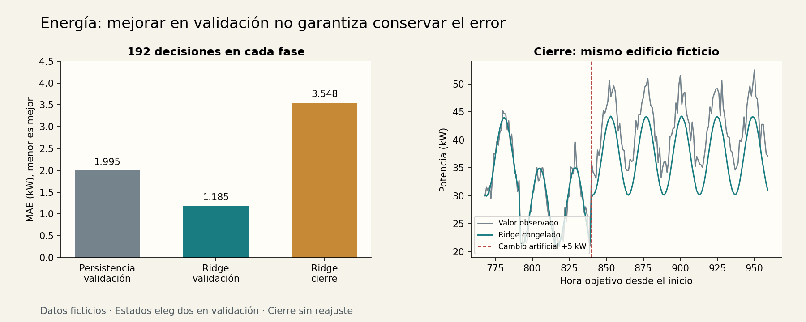

# Taller 1 — Energía e IoT: pronosticar una hora

[Unidad 34](../README.md) · [Datos](../datos/README.md) · [Código](../ejemplos/energia.py)

## Encargo y decisión

Un responsable de un edificio ficticio quiere revisar una estimación de potencia para la hora siguiente. Recibe una lectura actual en kW y conoce el calendario de la próxima hora. La salida informa la estimación y si el consumo de entrada está fuera del rango visto al entrenar. Una persona contrasta el resultado antes de planear una acción; el programa no controla cargas ni calcula ahorro económico.

**Pregunta evaluable:** en horas posteriores del mismo edificio sintético, ¿qué error conserva el estado elegido con validación? No se evalúan edificios nuevos ni lecturas ausentes o tardías. Conecta [regresión](../../unidad11-regresion/README.md) con [series temporales](../../unidad23-series-temporales/README.md).

## Antes de ejecutar

Hay 960 lecturas horarias y 959 decisiones a una hora. Para el objetivo en `t`, la entrada contiene la lectura de `t−1`, la hora de `t` y si ese día es laboral. Se supone que la lectura está disponible inmediatamente en `t−1`. En un sensor real habría que verificar su hora de llegada, como en la Unidad 23.

| Fase | Horas objetivo | Decisiones | Uso |
|---|---|---:|---|
| Entrenamiento | 1–575 | 575 | Aprender escala y coeficientes |
| Validación | 576–767 | 192 | Elegir entre dos candidatos |
| Prueba | 768–959 | 192 | Evaluar solo al elegido |

Los objetivos de entrenamiento están disponibles antes o en el primer origen de validación. Lo mismo ocurre entre validación y prueba. En prueba se permite usar la lectura recién observada en cada origen: es pronóstico progresivo a una hora, **no un pronóstico de las 192 horas desde un único instante**.

No se barajan filas. La identidad del edificio y la fórmula generadora no son entradas del predictor.

## Referencia y candidato

La persistencia predice `potencia(t) = potencia(t−1)`. Es barata, aprovecha la última lectura y establece qué aporta el modelo.

Ridge usa cuatro características:

```text
x = [consumo_actual_kw, sin(2π·hora_siguiente/24),
     cos(2π·hora_siguiente/24), laboral_siguiente]
z = (x − media_entrenamiento) / escala_entrenamiento
predicción = intercepto + z·coeficientes
```

Seno y coseno colocan 23:00 y 00:00 cerca en el ciclo diario. El ajuste minimiza la suma de errores cuadrados más `α·Σ coeficiente²`, con α=1 y sin penalizar el intercepto. Se usa `StandardScaler` y `Ridge(solver="svd")`; el criterio de selección es MAE, que no es la función de ajuste. [Ridge en scikit-learn](https://scikit-learn.org/stable/modules/generated/sklearn.linear_model.Ridge.html)

No se explora una rejilla después de ver prueba. En empate exacto de MAE se conserva el orden del protocolo: primero persistencia. El estado elegido mantiene el ajuste de las 575 filas; no se vuelve a entrenar con validación.

## Ejecuta, congela y cierra

Desde la raíz del curso:

```bash
python unidad34-talleres-ia-aplicada/ejemplos/01_taller_energia.py --salida resultados/u34-energia
python unidad34-talleres-ia-aplicada/ejemplos/01_taller_energia.py --evaluar-prueba --modelo resultados/u34-energia/modelo.json --salida resultados/u34-energia
```

El primer comando crea `modelo.json` y `validacion.json`. El segundo exige ese modelo y crea `prueba.json`; no ajusta ni reabre una competencia de candidatos.

```text
persistencia: MAE=1.9953 kW; n=192
ridge_1: MAE=1.1853 kW; n=192
Seleccionado energia: ridge_1. Recarga idéntica; prueba sin abrir.
Cierre energia: ridge_1: MAE=3.5479 kW; n=192
```

## Interpreta el fallo



La serie contiene un aumento artificial de +5 kW desde la hora 840. El modelo fijo queda bajo: el sesgo medio de cierre, `predicho−observado`, es −3,1386 kW. En las 72 decisiones previas al cambio su MAE es 1,1534; en las 120 posteriores, 4,9846. Son diagnósticos del estado ya elegido, no una nueva regla de selección.

El detector simple de rango marca 29 de 192 entradas. Solo mira el consumo actual frente al mínimo y máximo de entrenamiento. No es un detector completo de cambio: puede fallar aunque el valor siga dentro del rango. No contamos esas marcas como aciertos ni retiramos esos casos del MAE.

La mejora frente a persistencia se comprobó en validación. El cierre publicado solo evalúa Ridge; no demuestra una ventaja frente a persistencia en ese periodo. Tampoco demuestra ahorro energético. La decisión de esta entrega es conservarlo como demostración y diseñar una evaluación con datos reales antes de usarlo para actuar.

## Demostración y entradas problemáticas

Contrato ilustrativo:

```json
{"consumo_actual_kw": 35.0, "hora_siguiente": 14, "laboral_siguiente": 1}
```

El consumo debe ser finito entre 0 y 200 kW; hora, un entero entre 0 y 23; laboral, el entero 0 o 1. Los límites son del contrato didáctico, no de una instalación real. Se rechazan booleanos, campos extra, ausencias y `NaN`. Un valor permitido pero fuera del rango observado produce `estado="revisar"`; también se marca una estimación negativa. No se corrige silenciosamente la salida ni se afirma que toda entrada dentro del rango sea fiable.

```bash
python unidad34-talleres-ia-aplicada/ejemplos/04_demostrar_taller.py --taller energia --modelo resultados/u34-energia/modelo.json
```

## Entrega del taller

Conserva el modelo, los dos informes, el contrato y una explicación del cambio de nivel. Verifica a mano tres errores absolutos de `prueba.json`; su media parcial no es el MAE completo. Aceptación didáctica: reproducir los conteos, respetar los cortes y explicar por qué la selección favorable no basta para autorizar control automático.

**Experimenta:** formula un nuevo protocolo para horizonte de seis horas. Identifica qué lecturas y calendarios estarían disponibles; no sustituyas simplemente `t−1` por una variable futura. Reserva un periodo nuevo antes de comparar modelos.
