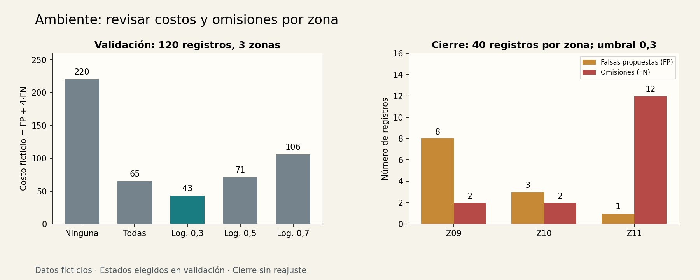

# Taller 2 — Gestión ambiental: proponer revisiones

[Unidad 34](../README.md) · [Datos](../datos/README.md) · [Código](../ejemplos/ambiente.py)

## Encargo y alcance

Un equipo de campo ficticio recibe fichas de pequeñas áreas y quiere proponer cuáles revisar primero. Cada ficha contiene densidad de residuos, porcentaje de superficie afectada y días sin visita. La etiqueta artificial indica «revisión prioritaria»; una persona revisa las propuestas antes de planear una visita.

El taller no estima toxicidad, no clasifica cumplimiento de normas y no decide sanciones. Los datos y el costo son construcciones didácticas. Se conecta con [clasificación](../../unidad12-clasificacion/README.md), [validación por grupos](../../unidad16-validacion-hiperparametros/README.md) y [costos y umbrales](../../unidad17-metricas-decisiones/README.md).

**Pregunta evaluable:** ¿cómo se comporta una política elegida en zonas conocidas de desarrollo al aplicarla a otras zonas ficticias? La zona identifica el grupo de evaluación; no entra como característica.

## Protocolo por zonas

Cada una de doce zonas contiene cuarenta registros. Z00–Z05 se usan para entrenamiento, Z06–Z08 para validación y Z09–Z11 para cierre: 240/120/120 registros. No se reparten al azar filas de la misma zona entre fases. Los registros no tienen orden temporal ni pretenden representar series de campo.

El generador modifica la propensión de la etiqueta entre zonas, incluida una variación común en las de cierre. La función que genera la etiqueta no se entrega al predictor. Una partición por grupos evita compartir identidades; no elimina automáticamente diferencias de distribución ni hace representativa la muestra.

## ¿Por qué este umbral?

Primero compara «ninguna» y «todas». Después ajusta una única regresión logística con escala aprendida en entrenamiento, C=1, solver `lbfgs`, tolerancia 1e−8 y máximo de 1000 iteraciones. Los umbrales 0,3; 0,5 y 0,7 comparten exactamente los mismos pesos.

```text
z = (entrada − media_entrenamiento) / escala_entrenamiento
s = sigmoide(intercepto + z·coeficientes)
proponer_revision = 1 si s ≥ umbral; 0 en otro caso
costo = FP + 4·FN
```

Omitir un positivo cuesta cuatro unidades; proponer una revisión de un negativo cuesta una. Estos valores se fijaron en el protocolo, no se estimaron a partir del cierre. La logística produce una puntuación entre 0 y 1; aquí no se comprueba calibración de probabilidades en campo. [LogisticRegression](https://scikit-learn.org/stable/modules/generated/sklearn.linear_model.LogisticRegression.html)

La selección minimiza costo total de validación. En empate elige menos propuestas y luego el orden del protocolo. No hay cupo ni optimización de rutas: priorización significa una propuesta binaria para revisión, no una agenda operativa completa.

## Ejecuta

```bash
python unidad34-talleres-ia-aplicada/ejemplos/02_taller_ambiente.py --salida resultados/u34-ambiente
python unidad34-talleres-ia-aplicada/ejemplos/02_taller_ambiente.py --evaluar-prueba --modelo resultados/u34-ambiente/modelo.json --salida resultados/u34-ambiente
```

| Candidato | FP en validación | FN en validación | Costo |
|---|---:|---:|---:|
| Ninguna | 0 | 55 | 220 |
| Todas | 65 | 0 | 65 |
| Logística, 0,3 | 7 | 9 | **43** |
| Logística, 0,5 | 3 | 17 | 71 |
| Logística, 0,7 | 2 | 26 | 106 |

Con umbral 0,3 se proponen 53 revisiones: 46 verdaderos positivos y 7 falsos positivos. Hay 58 verdaderos negativos. El costo es `7+4·9=43`. La política de menos propuestas no gana por ese solo hecho: el costo tiene prioridad.

## Cierre y desigualdad entre zonas



El estado congelado propone 65 revisiones en cierre: 53 TP, 12 FP, 16 FN y 39 TN. El costo es `12+4·16=76` sobre 120 registros. La precisión entre propuestas es 53/65=0,8154 y la recuperación de positivos es 53/69=0,7681.

| Zona de cierre | Registros | FP | FN | Costo | Recall |
|---|---:|---:|---:|---:|---:|
| Z09 | 40 | 8 | 2 | 16 | 12/14 |
| Z10 | 40 | 3 | 2 | 11 | 24/26 |
| Z11 | 40 | 1 | 12 | 49 | 17/29 |

Z11 tiene precisión alta entre sus propuestas, 17/18, pero omite doce positivos. Mostrar solo esa precisión ocultaría el problema. Los costos por zona suman 76; promediar recalls sin indicar pesos responde otra pregunta.

El cierre evalúa únicamente el umbral elegido. No se baja a 0,2 después de ver Z11. El resultado se conserva como motivo para revisar datos, representación, costo y condiciones de uso en una nueva versión; no acredita eficacia ambiental real.

## Contrato y demostración

```json
{"residuos_m2": 8.0, "superficie_afectada_pct": 65.0, "dias_sin_visita": 20}
```

Rangos del contrato: densidad de 0 a 20 residuos/m², superficie de 0 a 100 % y días como entero de 0 a 60. Se rechazan faltantes, booleanos, valores no finitos y campos extra. Una entrada válida fuera de los mínimos/máximos de entrenamiento se marca, sin descartarla silenciosamente. La salida siempre incluye `requiere_revision_humana=true`.

```bash
python unidad34-talleres-ia-aplicada/ejemplos/04_demostrar_taller.py --taller ambiente --modelo resultados/u34-ambiente/modelo.json
```

## Entrega del taller

Entrega la matriz de confusión total, los tres resúmenes por zona, el costo declarado y una nota sobre capacidad de visitas. Aceptación didáctica: reconstruir el costo y justificar la revisión humana con errores concretos. Una decisión de uso requiere además acordar con el equipo real costos, calidad de etiquetas, alcance y capacidad.

**Experimenta:** plantea un cupo de diez visitas por lote en una versión nueva. Una puntuación por encima del umbral no resuelve ese cupo; habría que definir ranking, desempate, tamaño del lote y evaluación con grupos completos. Usa la Unidad 17 como referencia y prepara nuevas zonas de cierre.
