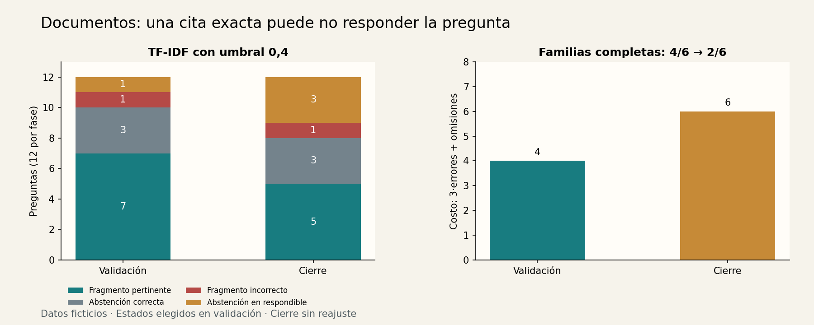

# Taller 3 — Educación y documentos: consultar con citas

[Unidad 34](../README.md) · [Datos](../datos/README.md) · [Código](../ejemplos/documentos.py)

## Encargo y contrato

Un estudiante de una institución ficticia necesita encontrar un procedimiento en diez documentos breves. El asistente devuelve el párrafo completo y su cita o declara `sin_evidencia`. La persona lee el fragmento para comprobar si responde su pregunta.

Esta es una solución **extractiva**, sin generación con un LLM. Permite integrar recuperación, abstención, procedencia y evaluación con CPU y archivos locales. Retoma [TF-IDF](../../unidad22-lenguaje-natural/README.md) y la distinción entre [cita y apoyo](../../unidad29-rag-documentos/README.md). No evalúa estudiantes, no consulta expedientes y no contiene información de personas reales.

## Corpus y reserva de preguntas

El corpus fijo contiene diez párrafos D01–D10, todos de versión 1. Incluye ocho procedimientos consultables y dos documentos cercanos que pueden confundir la recuperación: cancelar una sala y devolver un equipo dañado. El texto completo de cada documento es una unidad de recuperación; no se mezclan versiones ni se resuelven contradicciones en este taller.

| Fase | Familias de preguntas | Preguntas | Respondibles / sin respuesta |
|---|---|---:|---:|
| Validación | Reserva, préstamo, entrega, wifi, salud, pago | 12 | 8 / 4 |
| Prueba | Tutoría, certificado, renovación, accesibilidad, beca, transporte | 12 | 8 / 4 |

Cada familia tiene dos formulaciones. Se reserva la familia completa para evitar repartir paráfrasis de la misma intención entre fases. Las familias «salud», «pago», «beca» y «transporte» no tienen respuesta en el corpus; algunas preguntas comparten palabras con un procedimiento existente.

El índice se ajusta con los diez documentos desde el principio, incluidos los que responderán preguntas de cierre. Eso representa búsqueda en una base conocida. No se ajusta vocabulario con las preguntas ni se usan sus etiquetas para calcular similitud. La reserva de familias evalúa nuevas consultas a esa misma base, no conocimiento nuevo, nuevos documentos o comprensión general.

## Dos formas de buscar y una de abstenerse

La referencia divide el número de palabras distintas compartidas por el número de palabras distintas de la consulta. Ambos métodos pasan texto a minúsculas, retiran tildes, separan secuencias de letras/números y eliminan una lista corta explícita de palabras frecuentes. No se hace lematización ni expansión semántica.

TF-IDF usa conteos de términos y la ponderación suavizada:

```text
idf(t) = log((1 + número_documentos) / (1 + documentos_con_t)) + 1
vector(t) = conteo(t) · idf(t)
```

Se normaliza cada vector por su norma L2 y se usa el producto escalar como coseno. Las pruebas contrastan vocabulario, IDF y matriz con `TfidfVectorizer` usando el mismo tokenizador. [Referencia de TF-IDF](https://scikit-learn.org/stable/modules/generated/sklearn.feature_extraction.text.TfidfVectorizer.html)

Se elige el documento de mayor puntuación; en empate, el ID alfabéticamente menor. TF-IDF se compara con umbrales 0; 0,2 y 0,4. Se devuelve un fragmento cuando su puntuación es **positiva y mayor o igual que el umbral**. Incluso con umbral cero, una consulta sin términos conocidos se abstiene. La puntuación no es una probabilidad de respuesta correcta.

La selección usa este costo:

| Resultado | Costo |
|---|---:|
| Fragmento esperado o abstención en pregunta sin respuesta | 0 |
| Abstención en pregunta respondible | 1 |
| Cualquier fragmento incorrecto, incluso ante una pregunta sin respuesta | 3 |

En empate elige menos respuestas y luego el orden del protocolo. El criterio recompensa la cautela de forma explícita, pero abstenerse de todo también cuesta en preguntas respondibles.

## Ejecuta y compara

```bash
python unidad34-talleres-ia-aplicada/ejemplos/03_taller_documentos.py --salida resultados/u34-documentos
python unidad34-talleres-ia-aplicada/ejemplos/03_taller_documentos.py --evaluar-prueba --modelo resultados/u34-documentos/modelo.json --salida resultados/u34-documentos
```

| Candidato | Aceptadas en validación | Respondidas | Costo |
|---|---:|---:|---:|
| Solapamiento | 9/12 | 11 | 9 |
| TF-IDF, 0 | 8/12 | 11 | 12 |
| TF-IDF, 0,2 | 8/12 | 11 | 12 |
| TF-IDF, 0,4 | **10/12** | 8 | **4** |

«Aceptada» significa que se recuperó el ID esperado o que se abstuvo ante una pregunta no respondible, según juicios propios fijados en el dataset. La salida siempre es un párrafo completo: no se valida la capacidad de redactar ni una respuesta más detallada que lo escrito en él.

## Cierre: contar respuestas y abstenciones



En cierre hay cinco fragmentos pertinentes, uno incorrecto, tres abstenciones correctas y tres abstenciones ante preguntas respondibles. Por tanto:

- Aceptadas: `(5+3)/12 = 8/12`.
- Cobertura: `(5+1)/12 = 6/12`.
- Precisión entre respondidas: `5/6`, no `8/12`.
- Costo: `3·1 + 1·3 = 6`.
- Familias con sus dos formulaciones aceptadas: 2/6, frente a 4/6 en validación.

Errores conservados:

| Pregunta | Resultado | Por qué importa |
|---|---|---|
| Q-tutoria-1 | Se abstiene; score 0,302 | Una paráfrasis puede compartir pocas palabras |
| Q-certificado-0 | Se abstiene; score 0,393 | Estar cerca del umbral no justifica moverlo usando cierre |
| Q-renovacion-1 | Se abstiene; score 0,265 | «Extender el tiempo» no se equipara automáticamente a «renovación» |
| Q-transporte-1 | Devuelve D05; score 0,426 | El documento dice cuándo es la tutoría, no si hay transporte |

En el último caso la cita es exacta y apunta a un párrafo existente, pero no responde la pregunta. Validar offsets comprueba procedencia; evaluar el ID esperado comprueba pertinencia dentro de estos juicios. Ninguno es un verificador semántico universal.

## Demostración

```json
{"pregunta": "¿Cómo reservar la sala Aurora?"}
```

```bash
python unidad34-talleres-ia-aplicada/ejemplos/04_demostrar_taller.py --taller documentos --modelo resultados/u34-documentos/modelo.json
```

Devuelve D01, versión 1, con offsets `[0,108)` medidos en caracteres Python del campo `texto`, no en bytes del archivo JSON. La respuesta es exactamente esa porción. El corpus va incluido en el estado guardado; cambiar el corpus exige una nueva versión del índice.

La pregunta debe tener entre 1 y 400 caracteres y no consistir solo en espacios. Se rechazan campos adicionales. Prueba `zxqv`: es texto válido, pero no hay términos conocidos y se obtiene `sin_evidencia`. Distingue rechazo del contrato, ausencia de evidencia y fragmento recuperado pero incorrecto.

## Entrega y siguiente experimento

Entrega las 24 preguntas con sus juicios, el corpus, el estado elegido, los informes y dos ejemplos: una cita pertinente y Q-transporte-1. Aceptación didáctica: reconstruir el costo, explicar la diferencia entre cobertura y precisión, y conservar las abstenciones y el error.

**Experimenta:** diseña una nueva evaluación con documentos contradictorios o versiones antiguas. Define cuál fuente está vigente y qué debería responder el sistema antes de cambiar el índice. Añadir un generador no soluciona por sí solo la falta de evidencia; compara su resultado con esta referencia extractiva y reserva nuevas familias.
