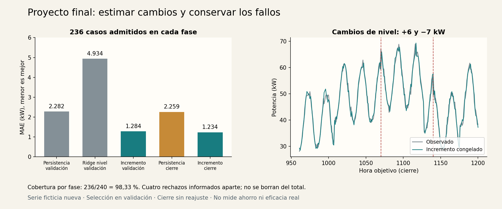
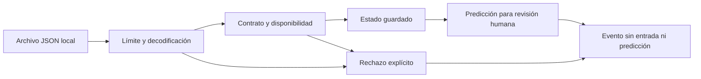

# Unidad 35 — Proyecto final integrador

[Índice del curso](../README.md) · [Unidad anterior](../unidad34-talleres-ia-aplicada/README.md) · [Revisión final del curso](../REVISION_FINAL.md)

**Pregunta guía:** ¿qué evidencia necesita otra persona para reproducir, evaluar y decidir cómo usar un proyecto de IA?

Esta unidad cierra la ruta con un proyecto completo de referencia y una guía para desarrollar el tuyo. Integra formulación, datos, preparación, referencia, modelos, evaluación, demostración, operación y documentación. Un buen proyecto puede terminar en una decisión de revisión o descarte; no necesita una métrica perfecta, un modelo grande o un servicio público.

El proyecto de referencia es un **asistente de revisión de potencia horaria** para un edificio ficticio. Retoma el problema del taller de energía, conserva su código compartido e incorpora una serie nueva, disponibilidad de lecturas y un predictor del incremento. Las conclusiones de la Unidad 34 motivan la hipótesis; sus datos y su cierre no se reutilizan para elegir esta nueva versión.

## Objetivos y preparación

Al terminar podrás:

1. Acordar usuario, decisión, contrato, referencia y criterio antes de ejecutar.
2. Distinguir un rechazo por calidad/disponibilidad del dato de un error del modelo.
3. Congelar una elección y evaluar su cierre junto a una referencia previamente fijada.
4. Entregar una demostración trazable, pruebas y una forma explícita de volver a la referencia.
5. Defender resultados y limitaciones con casos verificables y documentos suficientes.

Prerrequisitos: [proyecto de IA](../unidad02-proyecto-ia/README.md), [regresión](../unidad11-regresion/README.md), [evaluación](../unidad16-validacion-hiperparametros/README.md), [series temporales](../unidad23-series-temporales/README.md), [operación](../unidad33-operacion-seguridad-observabilidad/README.md) y [talleres](../unidad34-talleres-ia-aplicada/README.md). Dedicación orientativa: 5–7 horas para reproducir y analizar este proyecto; el tiempo de uno propio depende de su alcance.

Se verificó el 10 de octubre de 2026 en un entorno virtual nuevo, sin paquetes del sistema: Python 3.12.3, NumPy 2.2.6, scikit-learn 1.9.1 y Matplotlib 3.10.8, en Linux x86_64. El proyecto usa CPU y archivos locales; no necesita Ollama, PyTorch, cuentas ni sockets. La comprobación de **todo el curso** sí instala PyTorch CPU y permite los sockets locales de las unidades 32–33. Consulta el [entorno registrado](recursos/entorno.json) y la [lista completa de paquetes](recursos/entorno-verificado.txt).

```bash
python -m pip install -r unidad35-proyecto-final/requirements.txt
```

Ejecuta los comandos desde la raíz del repositorio y con el entorno virtual activo. La instalación inicial puede requerir Internet; las prácticas posteriores funcionan sin conexión.

## 1. El encargo y sus límites

Una persona responsable de un edificio quiere revisar una estimación de potencia para la hora siguiente. El sistema recibe potencia actual y tres tiempos: medición, llegada y decisión. Devuelve una estimación, su instante objetivo y una marca de revisión si la entrada sale del rango observado. La persona decide qué investigar; el programa no controla cargas ni mide ahorro.

| Decisión previa | Definición en esta versión |
|---|---|
| Referencia | Persistencia: repetir la lectura actual |
| Candidatos | Persistencia, Ridge de nivel y Ridge de incremento |
| Selección | Menor MAE de validación sobre los mismos casos admitidos; empate por orden |
| Cierre | Evaluar elegido y persistencia guardados; no volver a seleccionar |
| Criterio didáctico | MAE ≤2 kW, reducción de MAE ≥10 % frente a persistencia y cobertura ≥95 % |
| Decisión permitida por la evidencia | Entrega didáctica reproducible; eficacia real todavía no evaluada |

Estos umbrales son ilustrativos y se fijaron en el [protocolo](datos/protocolo.json) antes de ejecutar. No son una norma industrial ni una tolerancia acordada con un edificio real. Se informa el criterio tanto en validación como en cierre; cumplirlo no convierte automáticamente el proyecto en un producto listo para operar.

## 2. Preparar sin mirar el futuro

La serie contiene 1201 lecturas y 1200 decisiones. Se separan por **hora objetivo**: 720 de entrenamiento, 240 de validación y 240 de prueba. Cada predicción usa una lectura del origen y calendario conocido. La [ficha de datos](datos/README.md) describe generación, unidades, errores inyectados y límites.

La lectura se mide a una hora en punto. Normalmente llega un minuto después y se decide a los cinco minutos. Se predice para una hora después de la medición: quedan **55 minutos desde la decisión**, no sesenta. Las fechas se normalizan a UTC−05:00 antes de calcular calendario.

Se rechazan lecturas que aún no habían llegado, potencia ausente o inválida y lecturas de más de quince minutos. Validación y prueba contienen cuatro incidencias cada una. Se aplican los mismos rechazos a todos los candidatos, sin mirar sus predicciones ni etiquetas. Por eso cada métrica usa 236 casos y la cobertura conserva el denominador de 240.

La entrada se permite solo si estaba disponible al decidir. El objetivo se conoce después y se utiliza para evaluar. Separar fases antes de ajustar transformaciones mantiene esa distinción también durante entrenamiento. [Prevención de filtración en scikit-learn](https://scikit-learn.org/stable/common_pitfalls.html)

## 3. Una hipótesis concreta: predecir el cambio

El Ridge de nivel reutiliza sin modificar [energia.py de la Unidad 34](../unidad34-talleres-ia-aplicada/ejemplos/energia.py), pero se ajusta con las 720 filas nuevas. Conserva α=1 y las características de aquella práctica: potencia actual, seno/coseno de la próxima hora y calendario laboral.

El candidato nuevo aprende el incremento:

```text
entrada = [sin(hora_siguiente) − sin(hora_actual),
           cos(hora_siguiente) − cos(hora_actual),
           laboral_siguiente − laboral_actual]
objetivo_entrenamiento = potencia_siguiente − potencia_actual
incremento_estimado = intercepto + entrada_estandarizada · coeficientes
potencia_estimada = potencia_actual + incremento_estimado
```

Los ángulos son `2π·hora/24`. La media y escala se aprenden solo en entrenamiento; Ridge usa α=1, solver SVD e intercepto sin penalizar. [Documentación de Ridge](https://scikit-learn.org/stable/modules/generated/sklearn.linear_model.Ridge.html)

Si la potencia actual aumenta ocho kW y el calendario no cambia, la predicción de incremento aumenta exactamente ocho kW. Eso no es reentrenamiento en línea: los parámetros siguen fijos y cambia una entrada disponible. Tampoco permite anticipar un salto que aún no se observó. El error de la primera hora del salto sigue siendo un caso importante.

## 4. Ejecuta desarrollo y guarda la elección

```bash
python unidad35-proyecto-final/ejemplos/01_desarrollar_proyecto.py --salida resultados/proyecto-final
```

```text
persistencia: MAE=2.2821 kW; admitidas=236/240.
ridge_nivel: MAE=4.9344 kW; admitidas=236/240.
ridge_incremento: MAE=1.2840 kW; admitidas=236/240.
Proyecto elegido: ridge_incremento; recarga idéntica; prueba sin abrir.
```

El comando ajusta con entrenamiento, compara en validación y guarda `modelo.json` y `validacion.json`. El paquete conserva el elegido, persistencia, preparación, protocolo, IDs de ajuste, entorno y huellas de fuentes. No se reajusta con validación. Sin `--salida` solo imprime la comparación y comprueba la recarga.

## 5. Abre el cierre una vez que la decisión está fijada

```bash
python unidad35-proyecto-final/ejemplos/01_desarrollar_proyecto.py --evaluar-prueba --modelo resultados/proyecto-final/modelo.json --salida resultados/proyecto-final
```

El modelo de incremento obtiene **MAE 1,2341 kW**, frente a **2,2594 kW** de persistencia, sobre los mismos 236 casos. La reducción relativa es 45,38 % y la cobertura 236/240=98,33 %. Se cumplen los tres criterios didácticos. La referencia de cierre estaba fijada en el protocolo; no se usó el resultado para elegir otro candidato.



El promedio favorable convive con errores grandes: PF1070 tiene error absoluto 7,934 kW y PF1140, 8,366 kW, en los saltos de nivel. Se marcan 57 entradas fuera del rango de potencia observado al entrenar; permanecen dentro del MAE y no se presentan como fallos detectados con certeza. El [informe completado](recursos/informe.md) conserva esos casos y la decisión de uso.

La prueba es pública y sus respuestas ya están disponibles. Si modificas el modelo después de estudiarla, esa modificación necesita una evaluación nueva para sostener una afirmación de independencia.

## 6. Entrega una aplicación pequeña y comprobable



La [CLI](ejemplos/predecir.py) utiliza un servicio secuencial que carga el paquete una vez por proceso. La entrada de ejemplo está en [consulta.json](datos/consulta.json):

```bash
python unidad35-proyecto-final/ejemplos/predecir.py --entrada unidad35-proyecto-final/datos/consulta.json --modelo resultados/proyecto-final/modelo.json
python unidad35-proyecto-final/ejemplos/predecir.py --entrada unidad35-proyecto-final/datos/consulta.json --modelo resultados/proyecto-final/modelo.json --referencia
python unidad35-proyecto-final/ejemplos/02_probar_entrega.py --modelo resultados/proyecto-final/modelo.json --salida resultados/proyecto-final/entrega.json
```

La consulta conocida produce aproximadamente 43,761493161 kW; con `--referencia`, exactamente 42 kW. La reversión es explícita y figura en la respuesta y el evento. No se sustituye silenciosamente un error interno por una predicción aparentemente válida.

El laboratorio conserva ocho respuestas correlacionadas con ocho eventos: una estimación, una marca de revisión y seis rechazos. La referencia se prueba aparte. Los UUID y tiempos cambian en cada ejecución. Son comprobaciones funcionales con casos conocidos, no otra evaluación predictiva. Consulta [operación y traspaso](recursos/operacion.md) para límites, errores y recuperación.

## 7. Aceptación: tres condiciones simultáneas

Un ejemplo manual tiene MAE del modelo 1,5 kW y de la referencia 2 kW: mejora del 25 %. Pero admite solo 94 de 100 solicitudes. Con cobertura mínima 95 %, **no cumple el criterio conjunto**, aunque sus otras dos medidas sean favorables.

```bash
python unidad35-proyecto-final/soluciones/03_aceptacion_a_mano.py
```

El MAE describe los casos admitidos; la cobertura describe el alcance de esa predicción sobre las solicitudes. Ninguno reemplaza al otro. Si la referencia tiene error cero, la reducción relativa queda indefinida y este protocolo no declara cumplida esa condición.

## 8. Tu proyecto final

El [reto y la rúbrica](reto.md) permiten elegir energía, ambiente, educación/documentos u otro problema acotado. No necesitas usar todas las técnicas del curso. Entrega una solución proporcional al problema y conserva una referencia que permita decidir si la complejidad aporta algo.

Usa la [plantilla de propuesta e informe](plantillas/proyecto.md) y el [checklist de traspaso](plantillas/traspaso.md). La [defensa del proyecto de referencia](recursos/defensa.md) muestra cómo explicar problema, evidencia, fallo y decisión en pocos minutos. Resuelve los [diez ejercicios](ejercicios.md) antes de consultar las [soluciones](soluciones/README.md).

## Comprobación y cierre

```bash
python -m unittest discover -s unidad35-proyecto-final/pruebas -v
python unidad35-proyecto-final/ejemplos/figuras.py --salida resultados/proyecto-final/figuras
python herramientas/auditar_estructura.py
python herramientas/verificar_curso.py
```

Las 37 pruebas del proyecto contrastan ecuaciones, temporalidad, recarga, invariancia ante etiquetas, criterios, huellas de versión, errores y operación por CLI. La revisión conjunta añade las prácticas y pruebas de las unidades anteriores, con el alcance documentado en [la revisión final](../REVISION_FINAL.md).

- [ ] Puedo reconstruir selección, cierre y denominadores desde los archivos.
- [ ] Puedo explicar un fallo conservado y una condición de revisión.
- [ ] Otra persona puede ejecutar la entrega con el entorno declarado.
- [ ] Mi proyecto propio distingue evidencia nueva de datos ya consultados.

Esta es la última unidad de la ruta, de la 0 a la 35. Cierra la elaboración del material; completar el aprendizaje exige resolver las prácticas, recibir retroalimentación y defender tu propio proyecto.

---

### ¿Necesitas apoyo con este tema?

Si te bloqueaste con la práctica, necesitas revisar tu entorno o adaptar lo aprendido a tu proyecto, podemos trabajarlo en una sesión personalizada.

[**Solicitar asesoría para este tema por WhatsApp**](https://wa.me/573103618296?text=Hola%2C%20Leli.%20Estoy%20estudiando%2035%20%C2%B7%20Proyecto%20final%20integrador%20del%20curso%20Inteligencia%20Artificial%3A%20fundamentos%20y%20aplicaciones%20%28https%3A%2F%2Fgithub.com%2Flelyliliana%2FCurso-Inteligencia-Artificial%2Ftree%2Fmain%2Funidad35-proyecto-final%29%20y%20necesito%20una%20asesor%C3%ADa%20personalizada.%20Mi%20duda%20es%E2%80%A6)
